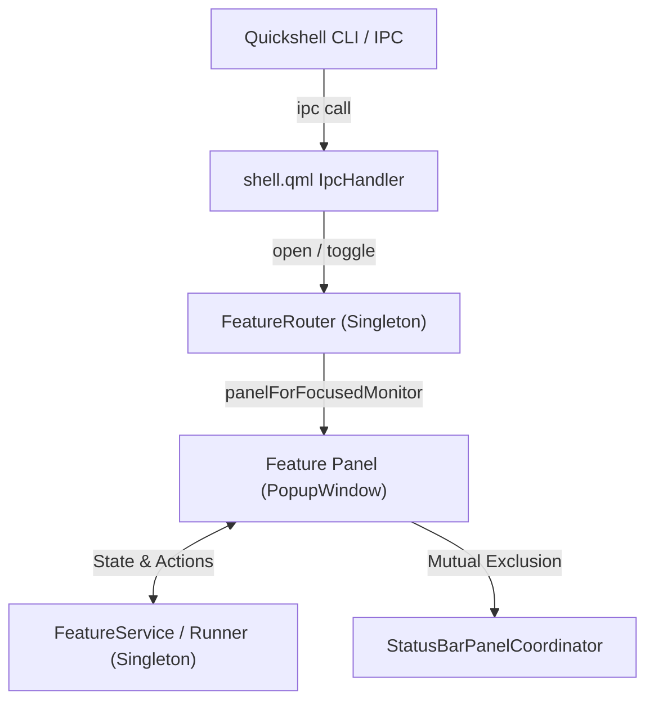

# AGENTS.md — Quickshell Developer & Agent Playbook

> **Scope**: Canonical conventions, architectural contracts, design tokens, and best practices for the `ashell` Quickshell environment (`/home/rajat/.config/quickshell/ashell`).
> **Audience**: AI Coding Agents & Human Contributors.

---

## 1. System Philosophy & Overview

`ashell` is a lightweight, responsive desktop shell built on **Quickshell** for Wayland compositors (specifically **Hyprland**). It provides a floating top bar, dynamic workspaces, hardware telemetry, network/bluetooth center, power management, and an application launcher.

### Core Principles
1. **Zero UI Jank**: Never block the main QML render thread with synchronous shell commands or disk I/O.
2. **Immutable Theme Foundation**: [Colors.qml](file:///home/rajat/.config/quickshell/ashell/Colors.qml) is strictly read-only. All components consume existing color tokens without modifying the core palette.
3. **Strict Motion System**: No magic numbers for animation durations or easing curves. Always import and reference [Motion.qml](file:///home/rajat/.config/quickshell/ashell/components/Motion.qml).
4. **Modular Architecture over Monoliths**: Keep components decomposed, readable, and under 300–400 lines by extracting reusable widgets into `components/`.
5. **Multi-Monitor First**: Never assume a single display. Every popup and status bar panel must support dynamic multi-monitor attachment and clean lifecycle destruction.

---

## 2. Directory Structure & Module Resolution

```text
/home/rajat/.config/quickshell/ashell/
├── shell.qml                # Root entry point: ShellRoot, global IPC handlers, screen variants
├── qmldir                   # Singleton declarations and module export: "module qs"
├── Colors.qml               # IMMUTABLE theme token definitions (singleton Colors)
├── constants/
│   └── Paths.qml            # External filesystem & script paths
├── components/              # Generic, theme-agnostic, reusable UI & logic primitives
│   ├── Motion.qml           # Global animation & easing engine (singleton Motion)
│   ├── Pill.qml             # Standard clickable/hoverable status bar capsule
│   ├── Poller.qml           # Non-blocking periodic CLI poller
│   ├── WorkspaceResolver.qml# Workspace monitor binding resolver
└── feature/                 # Domain-specific modules
    ├── bar/                 # Main status bar (Bar.qml, StatusBarService, PanelCoordinator)
    ├── launcher/            # App launcher & dynamic island (Launcher.qml, Router, Service)
    ├── network/             # Wi-Fi & Bluetooth manager (NetworkCenterView, Runners, Dialogs)
    └── powerprofile/        # Battery, power profiles & session control
```

### Module Registration (`qmldir`)
All singletons are declared in `qmldir` under module `qs`:
```qml
module qs
singleton Colors 1.0 Colors.qml
singleton Motion 1.0 components/Motion.qml
singleton WorkspaceResolver 1.0 components/WorkspaceResolver.qml
singleton StatusBarService 1.0 feature/bar/StatusBarService.qml
singleton StatusBarPanelCoordinator 1.0 feature/bar/StatusBarPanelCoordinator.qml
...
```
When creating files, use explicit imports:
```qml
import QtQuick
import QtQuick.Layouts
import Quickshell
import Quickshell.Hyprland
import qs
import qs.components
import qs.feature.bar
```

---

## 3. Architecture & Contracts

We enforce a **Pragmatic Dual-Tier Architecture**:

### Tier 1: Interactive & Popup Features (Router + Service + Decomposed UI)
Used for complex features with state, mutative actions, or popup windows (e.g., `network`, `launcher`, `powerprofile`):



1. **`<Feature>Router.qml` (Singleton)**:
   - Tracks active instances across monitors (`registrations: []`).
   - Resolves focused screen via `Hyprland.focusedMonitor`.
   - Handles IPC requests (`open()`, `close()`, `toggle()`).
2. **`<Feature>Service.qml` / `<Feature>State.qml` (Singleton)**:
   - Holds business logic, models, system telemetry, and command runners.
   - Completely decoupled from UI rendering.
3. **`<Feature>.qml` (PopupWindow / Item)**:
   - UI presentation layer anchored to a status bar `Pill`.
   - Subcomponents decomposed into smaller files (dialogs, list delegates, action bars).

### Tier 2: Bar-Only Indicators (Direct & Lightweight)
Used for simple telemetry or indicators on the bar (Clock, CPU Temperature, Volume reading):
- Do **not** create a separate feature folder or router.
- Define polling or data extraction in `feature/bar/StatusBarService.qml`.
- Instantiate a `Pill` directly inside `feature/bar/Bar.qml` bound to `StatusBarService`.

---

## 4. Multi-Monitor Coordination & Panel Lifecycle Contract

Every interactive popup panel (`PopupWindow`) **must** adhere strictly to this lifecycle contract:

### 1. Registration & Teardown
Popups must register with both `StatusBarPanelCoordinator` and their `<Feature>Router` when created or when their parent screen changes, and cleanly unregister upon destruction:

```qml
// In Bar.qml or inside the panel component:
onScreenChanged: {
    if (screen) {
        FeatureRouter.registerPanel(screen, featurePanel);
        StatusBarPanelCoordinator.registerPanel(screen, featurePanel);
    }
}
Component.onCompleted: {
    FeatureRouter.registerPanel(bar.screen, featurePanel);
    StatusBarPanelCoordinator.registerPanel(bar.screen, featurePanel);
}
Component.onDestruction: {
    FeatureRouter.unregisterPanel(featurePanel);
    StatusBarPanelCoordinator.unregisterPanel(featurePanel);
}
```

### 2. Standard Panel Public API
Every popup panel must implement:
- `openNow(argument)`: Immediately opens the panel, resets animations, and grants focus.
- `requestClose()`: Triggers exit animation before setting `visible = false`.
- `closeImmediate()`: Closes immediately without animation (used by `StatusBarPanelCoordinator` during rapid panel switching).
- `readonly property bool isOpen`: Indicates active or opening state.
- `property bool closingWithAnimation`: Prevents re-opening or focus glitches during exit transitions.

### 3. Mutual Exclusion
`StatusBarPanelCoordinator.openPanel(panel, argument)` ensures opening a panel automatically dismisses any open sibling panels on the same display, preventing overlapping popups.

### 4. Hyprland Focus Grabbing & Keyboard Traps
Popups requiring keyboard input (like search bars or credential prompts) must wrap focus handling:
```qml
HyprlandFocusGrab {
    id: focusGrab
    windows: [bar]
    active: panel.isOpen && !panel.closingWithAnimation
    onActiveChanged: {
        if (active)
            panel.focusPrimaryTarget();
    }
    onCleared: {
        if (panel.isOpen && !panel.closingWithAnimation)
            panel.requestClose();
    }
}

Shortcut {
    sequence: "Escape"
    context: Qt.ApplicationShortcut
    enabled: panel.visible && !panel.closingWithAnimation
    onActivated: panel.requestClose()
}
```

---

## 5. Component Extraction & Anti-Monolith Policy

> [!IMPORTANT]
> **Anti-Monolith Mandate**: Monolithic QML files exceeding **300–400 lines** are strictly discouraged. Always extract distinct UI sections into isolated, reusable components.

### Extraction Rules:
1. **Generic Reusable Primitives (`components/`)**:
   - Elements used across multiple features belong in `components/`.
   - Examples: `Pill.qml`, action buttons, sliders, confirmation dialog modals, switch toggles.
2. **Feature Subcomponents (`feature/<name>/`)**:
   - Feature-specific UI elements should be extracted into their feature directory.
   - Examples: `NetworkCenterTabs.qml`, `WifiNetworkList.qml`, `BluetoothDeviceList.qml`, `NetworkCenterPasswordDialog.qml`.
3. **Component Interface Best Practices**:
   - Always name the root item `id: root`.
   - Expose explicit, strongly typed public properties at the top of the file.
   - Never rely on implicit ancestor scope (`parent.parent.something`). Pass required data or callbacks via typed properties and signals:
     ```qml
     // Good: explicit contract
     Item {
         id: root
         property string title: ""
         property bool active: false
         signal actionTriggered()
     }
     ```
   - Use `readonly property` for internal calculations to prevent accidental binding overwrites.

---

## 6. Design System & Styling Tokens

### Immutable `Colors.qml` Policy
> [!CAUTION]
> **`Colors.qml` is IMMUTABLE.** Never edit `Colors.qml` to add new colors or ad-hoc tokens. Agents and contributors must compose and strictly reuse the existing palette.

#### Color Token Matrix (30 Purpose-Driven Tokens):
| Token | Semantic Role |
| :--- | :--- |
| `Colors.background` | Primary window / shell root background (`#251219`) |
| `Colors.backgroundAlt` | Alternate container background (`#2a2328`) |
| `Colors.overlay` | Modal dialog backdrop dimming scrim |
| `Colors.surface` | Primary card / status bar pill resting background (`#2c1e25`) |
| `Colors.surfaceSoft` | Interactive hover surface / elevated list items (`#31272d`) |
| `Colors.surfaceMuted` | Subdued surface / input background / slider tracks (`#352f35`) |
| `Colors.surfaceElevated` | Floating modal dialogs & context popovers |
| `Colors.panel` | Glass / translucent popup panel background (harmonized with `surface`) |
| `Colors.solid` | Solid popup panel background fallback |
| `Colors.soft` | Subdued translucent card backdrop |
| `Colors.tip` | Tooltip container background |
| `Colors.text` | Primary body and header text (`#debeab`) |
| `Colors.textDim` | Secondary labels, captions, and muted icons (`#9b8577`) |
| `Colors.textFaint` | Disabled / hint / placeholder text |
| `Colors.textAccent` | High-contrast text on solid accent surfaces |
| `Colors.accent` | Primary accent highlight / active state (`#D57062`) |
| `Colors.accentSoft` | Translucent accent overlay for hovers & focus rings (16% alpha) |
| `Colors.accentAlt` | Secondary accent / alternate highlight (`#4E6A67`) |
| `Colors.accentAltSoft`| Translucent secondary accent overlay (16% alpha) |
| `Colors.success` | Successful states / good health telemetry (`#6B6966`) |
| `Colors.successSoft` | Translucent success badge / chip background (16% alpha) |
| `Colors.warning` | Warnings / medium-high load telemetry (`#4E6A67`) |
| `Colors.critical` | Errors / disconnects / destructive actions (`#3C6566`) |
| `Colors.criticalSoft` | Translucent danger for destructive hovers / badges (16% alpha) |
| `Colors.selectedBackground` | Solid active selection highlight |
| `Colors.selectedText` | Contrast text on selected items |
| `Colors.hover` | Standard micro-interaction hover overlay tint |
| `Colors.border` | Subtle divider / boundary lines (`#463233`) |
| `Colors.shadow` | Ambient soft drop shadow color |
| `Colors.shadowTip` | Deeper elevation drop shadow for popups |
*(Utility constant `Colors.clear` is `"transparent"`).*

### Motion & Animation Tokens (`Motion.qml`)
Never hardcode millisecond values or easing types:
- **Durations**:
  - `Motion.durationInstant` (75ms): Immediate hover color transitions.
  - `Motion.durationFast` (140ms): Micro-interactions, pill clicks, tooltips.
  - `Motion.durationNormal` (200ms): Tab changes, content crossfades.
  - `Motion.durationPanel` (260ms): Popup window expansions / slides.
  - `Motion.durationExit` (180ms): Dismiss animations.
  - `Motion.durationMorph` (250ms): Island width morphing.
  - `Motion.durationSlow` (320ms): Complex layout or multi-stage transitions.
- **Easing Curves**:
  - `Motion.easingStandard` (`Easing.OutCubic`): Natural deceleration for incoming UI.
  - `Motion.easingIn` (`Easing.InCubic`): Accelerating exit animations.
  - `Motion.easingInOut` (`Easing.InOutCubic`): Smooth symmetrical transitions.
  - `Motion.easingPress` (`Easing.OutQuad`): Quick press-down physics.
  - `Motion.easingBounce` (`Easing.OutBack`): Subtle pop overshoot.
  - `Motion.easingFluid` (`Easing.OutQuart`): Ultra-smooth dynamic panel resizing.
- **Scale Factors**:
  - `Motion.scaleNormal` (1.0)
  - `Motion.scaleHover` (1.025)
  - `Motion.scalePress` (0.96)

### Iconography & Aesthetics
- **Material Symbols**: Use Google Material Symbols glyph names as string ligatures (e.g. `"wifi"`, `"volume_up"`, `"music_note"`, `"lock"`, `"power_settings_new"`).
- **Borderless Depth**: Default `borderWidth: 0`. Use layered ambient drop shadows (`Colors.shadow`) and subtle surface elevation (`Colors.surfaceSoft`) to define hierarchy instead of harsh borders.

---

## 7. System Integration & Subprocesses

### Native Quickshell APIs First
Always prioritize built-in Quickshell interfaces over shell executions:
- Audio/Media: `Quickshell.Services.Mpris`
- Monitor/Workspace info: `Quickshell.Hyprland`
- Screens: `Quickshell.screens`

### Read-Only Periodic Telemetry (`Poller.qml`)
For hardware metrics not exposed natively, use [components/Poller.qml](file:///home/rajat/.config/quickshell/ashell/components/Poller.qml):
- Keep intervals conservative (`interval: 2000` to `5000` ms) to prevent CPU wakeups.
- Format poller shell output cleanly (e.g. `sh -c "cat /sys/class/thermal/..."`).
- Parse structured outputs in `StatusBarService.qml` using `split("|")`.

### Asynchronous Action Runners
Never run blocking commands on user interactions:
- Wrap actions in asynchronous `Process` instances with `StdioCollector`.
- For multi-step commands (e.g., Wi-Fi scan + connect), use an asynchronous command queue pattern (see `NetworkCommandRunner.qml`).
- Always store external script paths in [constants/Paths.qml](file:///home/rajat/.config/quickshell/ashell/constants/Paths.qml).

---

## 8. Step-by-Step Implementation Recipes

### Recipe A: Adding a New Status Bar Telemetry Pill
1. Open [feature/bar/StatusBarService.qml](file:///home/rajat/.config/quickshell/ashell/feature/bar/StatusBarService.qml):
   - Add a `Poller` with a reasonable interval (e.g. 3000ms).
   - Expose a sanitized `readonly property string myMetricValue: myPoller.value`.
2. Open [feature/bar/Bar.qml](file:///home/rajat/.config/quickshell/ashell/feature/bar/Bar.qml):
   - Add a `Pill` item inside `leftGroup` or `rightGroup`:
     ```qml
     Pill {
         icon: "memory"
         label: StatusBarService.myMetricValue
         textColor: Colors.text
         iconColor: Colors.accent
     }
     ```
3. Run `qmllint feature/bar/StatusBarService.qml feature/bar/Bar.qml` to verify syntax.

### Recipe B: Creating a Full Multi-Monitor Popup Feature
1. Create `feature/<name>/`:
   - `<Feature>Router.qml`: Implement multi-monitor registry (`registerPanel`, `unregisterPanel`, `panelForFocusedMonitor`, `open`, `close`, `toggle`).
   - `<Feature>Service.qml`: Expose data, models, and process execution.
   - `<Feature>.qml`: Root `PopupWindow` anchoring to a `Pill`, implementing lifecycle contract (`openNow`, `requestClose`, `closeImmediate`).
   - Decomposed subcomponents (e.g. `<Feature>List.qml`).
2. Register singletons in [qmldir](file:///home/rajat/.config/quickshell/ashell/qmldir):
   ```qml
   singleton <Feature>Router 1.0 feature/<name>/<Feature>Router.qml
   singleton <Feature>Service 1.0 feature/<name>/<Feature>Service.qml
   ```
3. Wire IPC into [shell.qml](file:///home/rajat/.config/quickshell/ashell/shell.qml):
   ```qml
   IpcHandler {
       target: "<name>"
       function open() { <Feature>Router.open(); }
       function close() { <Feature>Router.close(); }
       function toggle() { <Feature>Router.toggle(); }
   }
   ```
4. Mount the panel inside [feature/bar/Bar.qml](file:///home/rajat/.config/quickshell/ashell/feature/bar/Bar.qml):
   - Add anchor target `Pill`.
   - Instantiate `<Feature>` popup.
   - Connect registrations in `onScreenChanged`, `Component.onCompleted`, and `Component.onDestruction`.

---

## 9. Verification & Quality Gates

Before completing any task or committing changes, verify the following:

### 1. Static Linting
Run `qmllint` across every modified or newly added QML file:
```bash
qmllint shell.qml feature/bar/Bar.qml
```

### 2. Design Token Integrity Audit
Run grep checks to ensure no hardcoded colors or ad-hoc animation durations were introduced:
```bash
# Check for unapproved hex codes outside Colors.qml:
grep -rE '#[0-9a-fA-F]{3,8}' --exclude="Colors.qml" .

# Check that Colors.qml has zero uncommitted modifications:
git diff Colors.qml 2>/dev/null || true
```

### 3. Module & Singleton Consistency
Ensure every singleton referenced in code is registered with the correct path in [qmldir](file:///home/rajat/.config/quickshell/ashell/qmldir).

### 4. IPC & Runtime Validation
When testing against a running Quickshell instance:
```bash
qs -c ashell ipc call <target> <method>
```
Review logs for QML warnings, binding loops, or unresolved imports:
```bash
qs -c ashell log
```
